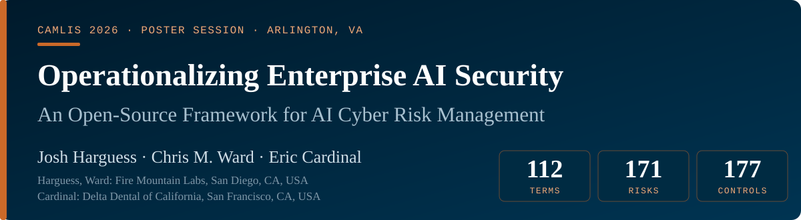
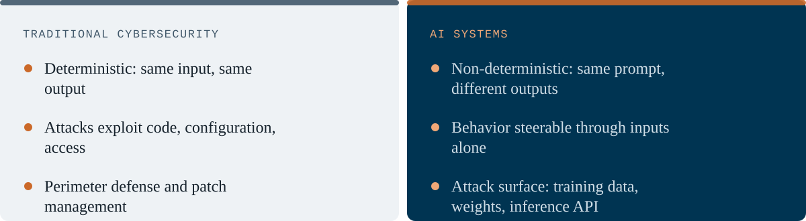
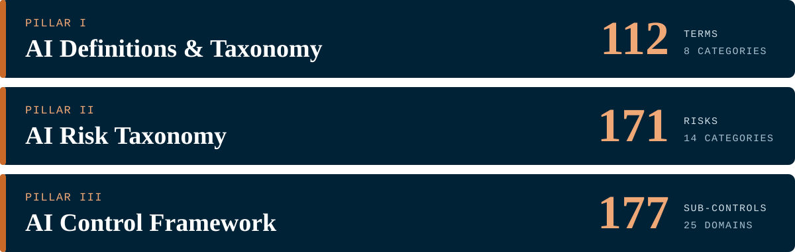
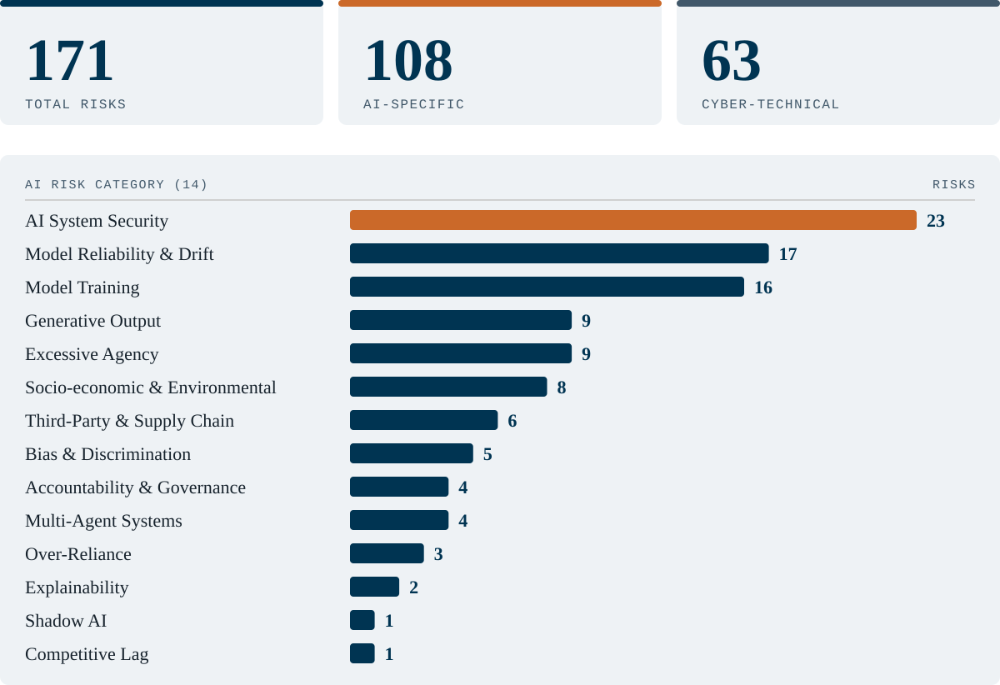
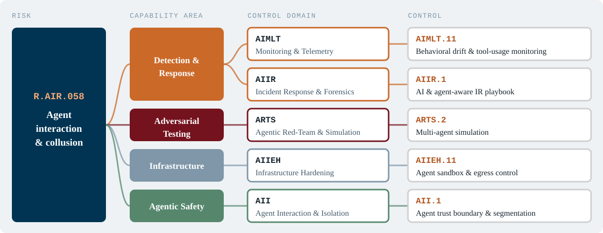
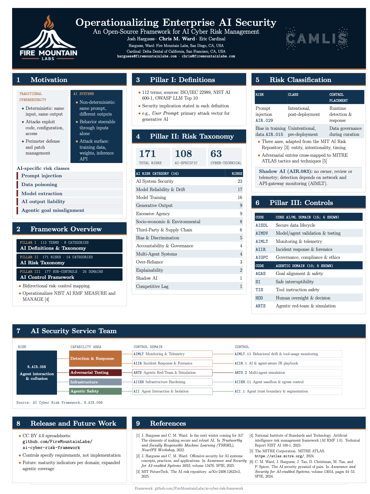

  

  
  

---

## 1 · Motivation

**AI-specific risk classes**

## 2 · Framework Overview

- Bidirectional risk–control mapping
- Operationalizes NIST AI RMF MEASURE and MANAGE [4]

## 3 · Pillar I: Definitions

- **112 terms**; sources: ISO/IEC 22989, NIST AI 600-1, OWASP LLM Top 10
- Security implication stated in each definition
- e.g., *User Prompt*: primary attack vector for generative AI

## 4 · Pillar II: Risk Taxonomy

Risk counts as a table

| AI risk category (14) | Risks |
| --- | ---: |
| AI System Security | 23 |
| Model Reliability & Drift | 17 |
| Model Training | 16 |
| Generative Output | 9 |
| Excessive Agency | 9 |
| Socio-economic & Environmental | 8 |
| Third-Party & Supply Chain | 6 |
| Bias & Discrimination | 5 |
| Accountability & Governance | 4 |
| Multi-Agent Systems | 4 |
| Over-Reliance | 3 |
| Explainability | 2 |
| Shadow AI | 1 |
| Competitive Lag | 1 |

## 5 · Risk Classification

| Risk | Class | Control placement |
| --- | --- | --- |
| Prompt injection `AIR.029` | Intentional, post-deployment | Runtime detection & response |
| Bias in training data `AIR.015` | Unintentional, pre-deployment | Data governance during curation |

- Three axes, adapted from the MIT AI Risk Repository [5]: entity, intentionality, timing
- Adversarial entries cross-mapped to MITRE ATLAS tactics and techniques [6]

> [!WARNING]
> **Shadow AI (`AIR.083`):** no owner, review or telemetry; detection depends on network and API-gateway monitoring (`AIMLT`).

## 6 · Pillar III: Controls

<table>
<tr><th>Code</th><th>Core AI/ML domain (15; 5 shown)</th><th>Code</th><th>Agentic domain (10; 5 shown)</th></tr>
<tr><td><code>AISDL</code></td><td>Secure data lifecycle</td><td><code>AGAS</code></td><td>Goal alignment &amp; safety</td></tr>
<tr><td><code>AIMDV</code></td><td>Model/agent validation &amp; testing</td><td><code>SI</code></td><td>Safe interruptibility</td></tr>
<tr><td><code>AIMLT</code></td><td>Monitoring &amp; telemetry</td><td><code>TIS</code></td><td>Tool instruction safety</td></tr>
<tr><td><code>AIIR</code></td><td>Incident response &amp; forensics</td><td><code>HOD</code></td><td>Human oversight &amp; decision</td></tr>
<tr><td><code>AIGPC</code></td><td>Governance, compliance &amp; ethics</td><td><code>ARTS</code></td><td>Agentic red-team &amp; simulation</td></tr>
</table>

## 7 · AI Security Service Team

Worked example: risk `R.AIR.058`, *Agent interaction & collusion*, traced through capability areas and control domains to individual controls.

Source: AI Cyber Risk Framework, R.AIR.058

## 8 · Release and Future Work

- CC BY 4.0 spreadsheets: [github.com/FireMountainLabs/ai-cyber-risk-framework](https://github.com/FireMountainLabs/ai-cyber-risk-framework)
- Controls specify requirements, not implementation
- Future: maturity indicators per domain; expanded agentic coverage

## 9 · References

1. J. Harguess and C. M. Ward. Is the next winter coming for AI? The elements of making secure and robust AI. *Trustworthy and Socially Responsible Machine Learning (TSRML), NeurIPS Workshop*, 2022.
2. C. M. Ward, J. Harguess, J. Tao, D. Christman, M. Tan, and P. Spicer. The AI security pyramid of pain. *Assurance and Security for AI-enabled Systems*, vol. 13054, pp. 44–53. SPIE, 2024.
3. J. Harguess and C. M. Ward. Offensive security for AI systems: concepts, practices, and applications. *Assurance and Security for AI-enabled Systems 2025*, vol. 13476. SPIE, 2025.
4. National Institute of Standards and Technology. Artificial Intelligence Risk Management Framework (AI RMF 1.0). NIST AI 100-1, 2023.
5. MIT FutureTech. The AI Risk Repository. arXiv:2408.12622v2, 2025.
6. The MITRE Corporation. MITRE ATLAS. https://atlas.mitre.org/, 2024.

---

## The poster

